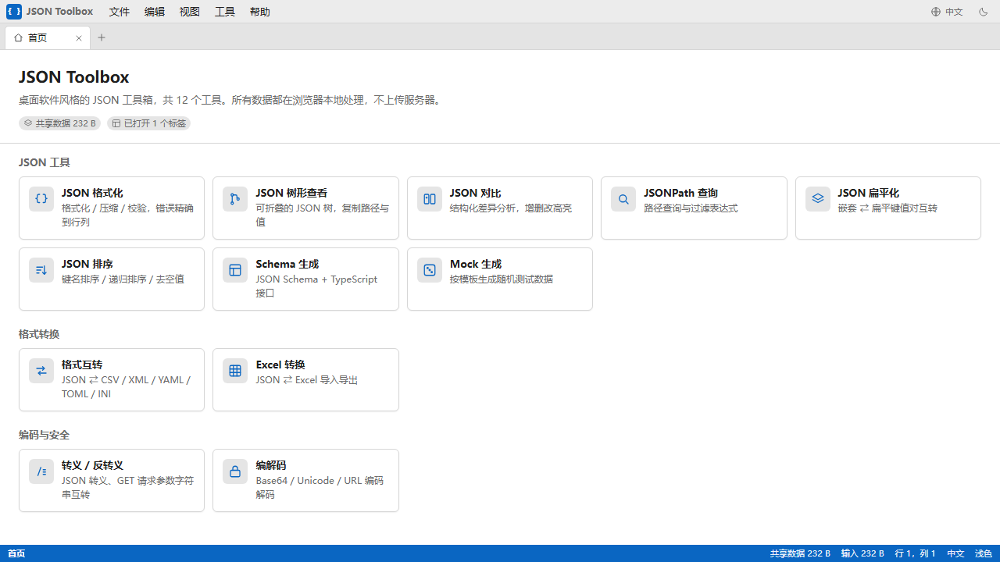
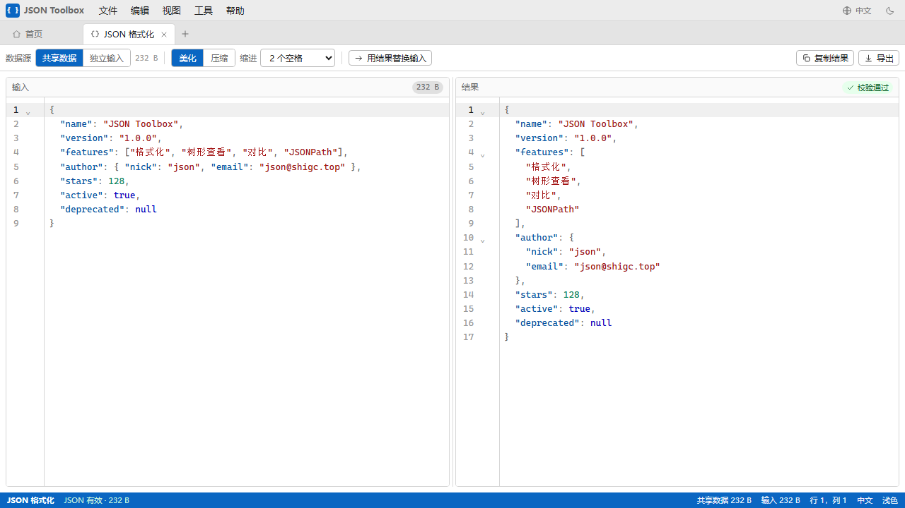

# JSON Toolbox

> A desktop-style, fully client-side JSON toolbox. 12 tools, 5 languages, zero uploads.

[](./LICENSE)
[](https://vuejs.org/)
[](https://vite.dev/)
[](https://www.typescriptlang.org/)

[English](./README.md) | [简体中文](./README.zh-CN.md) | [繁體中文](./README.zh-TW.md) | [日本語](./README.ja.md) | [한국어](./README.ko.md)

**[Live demo →](https://json.shigc.top/)**

<p align="center">
  
</p>

<p align="center">
  
</p>

## Why another JSON tool?

Most online JSON tools are a single textarea plus a button. JSON Toolbox instead
borrows the layout of a desktop application — menu bar, tabbed workspaces, status
bar, keyboard shortcuts — and keeps every operation in the browser. Nothing is
sent to a server, so it also works completely offline when built as a single
HTML file.

## Features

- **Desktop-style workspace** — menu bar, multi-tab editing, status bar, resizable panes
- **12 tools** covering formatting, inspection, transformation and conversion
- **100% local** — no backend, no analytics, no network requests at runtime
- **Offline single file** — `dist-single/index.html` runs by double-clicking it, no server needed
- **5 UI languages** — English, 简体中文, 繁體中文, 日本語, 한국어
- **Light / dark / system theme**
- **Keyboard shortcuts** and a command-style Tools menu
- **TypeScript** throughout, with strict type checking on every build

## Tools

| Tool | Description |
| --- | --- |
| JSON Format | Format, minify and validate, with line/column error reporting |
| JSON Tree View | Collapsible tree, copy paths and values |
| JSON Compare | Structural diff highlighting added, removed and modified nodes |
| JSONPath Query | Path queries and filter expressions |
| JSON Flatten | Convert between nested and flat key-value pairs |
| JSON Sort | Sort keys, recursive sort, drop empty values |
| Schema Generation | Generate JSON Schema and TypeScript interfaces |
| Mock Data | Generate random test data from a template |
| Format Conversion | JSON ⇄ CSV / XML / YAML / TOML / INI |
| Excel Conversion | Import and export JSON ⇄ Excel (`.xlsx`) |
| Escape / Unescape | Convert between JSON escaping and GET query strings |
| Encode / Decode | Base64 / Unicode / URL encoding and decoding |

## Tech stack

- [Vue 3](https://vuejs.org/) + TypeScript + [Vite 7](https://vite.dev/)
- [Pinia](https://pinia.vuejs.org/) for state, [Vue Router](https://router.vuejs.org/) in hash mode
- [CodeMirror 6](https://codemirror.net/) for the editor
- [vue-i18n](https://vue-i18n.intlify.dev/) for localisation
- [jsondiffpatch](https://github.com/benjamine/jsondiffpatch), [jsonpath-plus](https://github.com/JSONPath-Plus/JSONPath), [yaml](https://eemeli.org/yaml/), [fast-xml-parser](https://github.com/NaturalIntelligence/fast-xml-parser), [smol-toml](https://github.com/squirrelchat/smol-toml), [papaparse](https://www.papaparse.com/), [SheetJS](https://sheetjs.com/), [Faker](https://fakerjs.dev/)

## Getting started

### Requirements

- Node.js **20.19+** (or 22.12+)
- npm 10+

### Install and run

```bash
git clone https://github.com/shigc/json-toolbox.git
cd json-toolbox
npm install
npm run dev
```

The dev server prints a local URL (usually `http://localhost:5173`).

> `xlsx` is installed from `https://cdn.sheetjs.com/...tgz` because SheetJS no
> longer publishes new releases to npm. `npm install` therefore needs access to
> `cdn.sheetjs.com` in addition to the npm registry.

### Scripts

| Script | What it does |
| --- | --- |
| `npm run dev` | Start the Vite dev server |
| `npm run build` | Type-check and build an unminified bundle into `dist/` |
| `npm run build:single` | Build a single self-contained `dist-single/index.html` |
| `npm run build:release` | Build a minified + obfuscated bundle into `dist-release/` |
| `npm run preview` | Preview the `dist/` build |
| `npm run preview:release` | Preview the `dist-release/` build |
| `npm run typecheck` | Run `vue-tsc --noEmit` |
| `npm run deploy` | Build and deploy to Cloudflare Pages via Wrangler |

Set `SKIP_OBF=1` with `npm run build:release` to skip obfuscation while keeping
minification, which makes the release output easier to debug.

### Build outputs

| Directory | Purpose |
| --- | --- |
| `dist/` | Regular static build for hosting |
| `dist-single/` | One inlined HTML file, works from `file://` |
| `dist-release/` | Minified, obfuscated build for public deployment |

## Project structure

```
src/
├─ components/     layout, editor and common UI components
├─ composables/    reusable composition functions
├─ directives/     custom Vue directives
├─ locales/        zh-CN, zh-TW, en, ja, ko message catalogues
├─ router/         hash-mode routes generated from the tool registry
├─ stores/         Pinia stores (prefs, workspace, status)
├─ styles/         global styles and CSS variables
├─ tools/          tool registry and types
├─ utils/          pure helpers (json, diff, schema, mock, convert/*, encode)
└─ views/          one component per tool
```

The menu bar, tab bar, routes and home cards are all driven by
`src/tools/registry.ts`, so adding a tool does not require touching the router.

## Adding a new tool

1. Add an entry to `TOOLS` in `src/tools/registry.ts` (id, category, icon, accepted input).
2. Create the view component under `src/views/`.
3. Add `tool.<id>.title` and `tool.<id>.desc` to **all five** files in `src/locales/`.
4. Run `npm run typecheck` — `en.ts`, `ja.ts`, `ko.ts` and `zh-TW.ts` are checked
   against the `zh-CN.ts` key structure, so a missing key fails the build.

## Privacy

There is no backend. All parsing, conversion and generation happen in the
browser, and no data ever leaves the device. Preferences (theme, language,
layout) are persisted in `localStorage` only.

## Deployment

### GitHub Pages

`.github/workflows/deploy.yml` builds `dist/` and publishes it to GitHub Pages on
every push to `main`. Enable **Settings → Pages → Source: GitHub Actions** once.

The router uses hash mode and `base` is `./`, so the app also works when served
from a sub-path such as `https://<user>.github.io/json-toolbox/`.

### Cloudflare Pages

```bash
npm run deploy
```

The `deploy` script targets a Cloudflare Pages project named `json-toolbox`;
change `--project-name` in `package.json` (or run Wrangler directly) if you fork
the project. You will need to authenticate with `npx wrangler login` first.

## Contributing

Contributions are welcome. Please read [CONTRIBUTING.md](./CONTRIBUTING.md)
before opening a pull request. For security issues, follow
[SECURITY.md](./SECURITY.md) instead of opening a public issue.

## License

[MIT](./LICENSE) © 2026 JSON Toolbox contributors

Third-party dependencies keep their own licenses; see their package metadata for
details.
